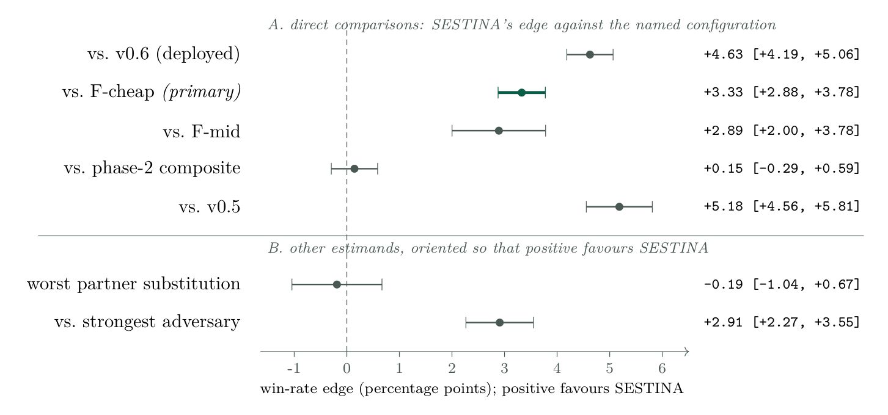
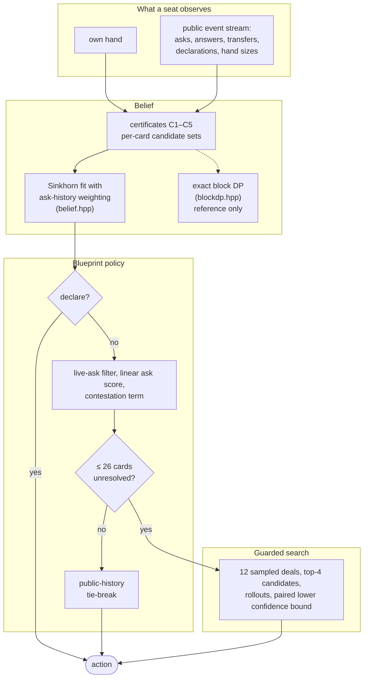
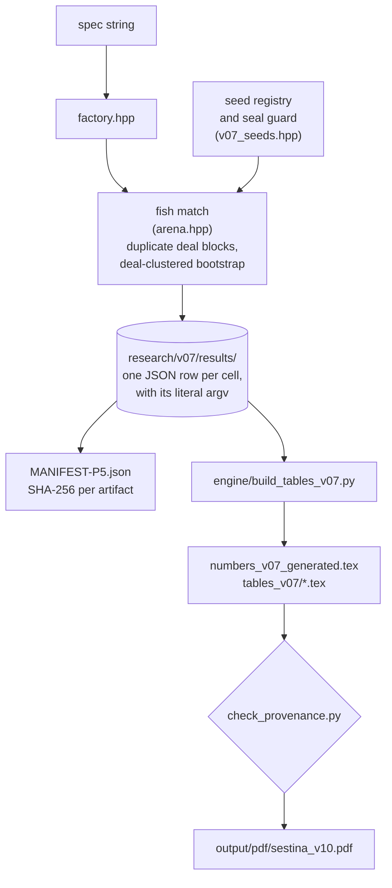
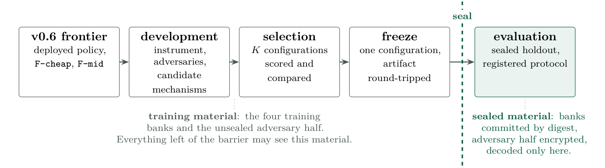

# FishLab

**An engine, a lineage of agents, and a preregistered evaluation for six-player Canadian Fish
(Literature), with every artifact behind the reported numbers.**

In Fish every card transfer is public, so a player's uncertainty reduces to a single object: the
initial deal. The deals consistent with what a seat has seen can be counted exactly, which makes the
game a clean testbed for imperfect-information team play. Inference has an exact reference, a desktop
plays hundreds of complete six-seat games a second, and a claim can be checked against stored
artifacts rather than argued. This repository holds the C++ engine, the FishBot lineage (v0.2 to
v0.6) and its successor **SESTINA v1.0**, the measurement apparatus, and the technical reports.

**[Technical report (PDF, 83 pp)](output/pdf/sestina_v10.pdf)** ·
[Architecture](#architecture) ·
[Methods](#evaluation-methodology) ·
[Results](#results) ·
[Limitations](#limitations) ·
[Reproduce](#reproducing-the-study) ·
[Play](#play-it)

<p align="center">
  
</p>

<p align="center"><sub>SESTINA v1.0's principal comparisons on sealed holdout banks (Figure 3 of the
report). Panel A is the head-to-head edge against each configuration; panel B holds two different
estimands, oriented so that positive favours SESTINA. Bars are nominal pooled 95% intervals; see
<a href="#limitations">Limitations</a>.</sub></p>

| | |
|---|---|
| **Hidden state** | the initial deal: from one seat's view, 45!/(9!)<sup>5</sup> ≈ 1.9 × 10<sup>28</sup> allocations of the other 45 cards |
| **Agent** | SESTINA v1.0, developed as FishBot v0.7: approximate constraint-based belief, linear ask and declaration policy, guarded endgame search |
| **Engine** | single-header C++20 core, 46 subcommands; 326 blueprint six-seat games per second on a 15-thread desktop |
| **Evaluation** | 428 scored cells, 4,322,400 games, preregistered protocol, two sealed holdout banks per claim |
| **Headline** | +3.33 pp against the registered baseline `F-cheap`; +0.15 pp, unresolved, against a composite assembled earlier in the same cycle |
| **Provenance** | every number in the report is a macro: 252 generated from this cycle's artifacts, 24 from earlier cycles', 155 transcribed under a named source |

---

## Research questions

The SESTINA report asks four questions, and the results section answers them in this order.

1. Does SESTINA achieve a replicated improvement over `F-cheap`, the registered baseline, on material
   sealed before SESTINA existed?
2. Does that improvement survive changes of partner, cross-play against separately trained policies,
   alternative rule variants, and adversarial responses fitted against it?
3. Which of SESTINA's changes account for the improvement, and which candidate mechanisms fail to
   produce measurable strength?
4. What do the results imply about the headroom remaining in the current policy class?

## Why this game

- **One hidden object.** A card changes hands only through an observed ask, so the public record
  determines every later card position given the deal. What a seat knows is a set of logical
  constraints on that deal, and those constraints factorise by half-suit.
- **A team that cannot talk.** Three teammates share a payoff, hold different private hands, and have
  no channel beyond their public actions. Coordination has to come from a shared policy and a shared
  observation.
- **A published, deterministic team.** Three copies of one agent have a public policy mapping and no
  private correlation signal. An adversary can read the policy and invert the transcript, which the
  report adopts as its adversary model.
- **Cheap simulation.** A deal resolves in roughly a hundred public events. That is what makes
  4.3 million evaluation games, two disjoint holdout banks per claim and eight adversarial searches
  affordable on one machine.

---

## Architecture

### The engine

The engine is a single-header C++20 core in [`engine/src/`](engine/src). A hand is one 64-bit word
over the 54 card indices, so hand arithmetic is bit arithmetic. Random streams are counter-based and
keyed by (seed, seat, purpose), so a deal and its play between deterministic agents reproduce from
the seed. An acting policy never receives the game state: it gets its own knowledge object, its own
hand and the public event stream, and has no reference to the deal or to another seat's hand.

Every policy is named by a single **spec string**, `base[:key=value,…]`, and
[`engine/src/factory.hpp`](engine/src/factory.hpp) is the authority on how a string becomes an agent.
SESTINA v1.0 is this string, recorded with its 55-coordinate parameter vector in
[`engine/fishbot_v07.json`](engine/fishbot_v07.json):

```
v07:r12=25,rtie=1,pool=-1,oppfloor=-1,force=1000000,askfloor=-1,stall=12,
    s1=1,det=12,cand=4,kappa=2.5,rbelief=indep,depth=12,maxq=26
```

The `v07` identifiers are kept on purpose. SESTINA v1.0 was developed and evaluated as FishBot v0.7,
and every seed, deal bank, digest and configuration string was committed and sealed under that name.

### One decision



1. **Belief.** Each public event adds hard constraints (C1–C5: own hand, card counts, transfers,
   failed asks, ask legality) to per-card candidate sets. The deployed belief is an iterative
   proportional (Sinkhorn) fit to those constraints, started from a two-parameter weighting of each
   seat's ask history ([`belief.hpp`](engine/src/belief.hpp)). The exact count of consistent deals
   ([`blockdp.hpp`](engine/src/blockdp.hpp)) is computed for validation and sits on no decision path.
2. **Declaration.** Between any two public events every seat may declare. For each live half-suit the
   agent selects the capacity-feasible allocation that maximises the product of approximate card
   marginals, prices it by sequential conditioning, and declares when a learned value comparison
   favours it ([`v05.hpp`](engine/src/v05.hpp)).
3. **Ask scoring.** A live-ask filter drops asks the seat can prove will miss; the rest are scored
   by a fitted linear function of twenty features plus three ownership terms and the contestation
   coordinate `r12` ([`v06.hpp`](engine/src/v06.hpp),
   [`v07_responder.hpp`](engine/src/v07_responder.hpp)).
4. **Ties.** Outside the endgame, a tied top score is broken by a hash of the public event digest,
   the seat and the event count, so a teammate can recompute the choice from the public record.
5. **Endgame search.** With at most 26 cards unresolved, the agent samples deals consistent with its
   constraints, plays each top candidate forward with every seat reconstructed at its own information
   set, and deviates from the blueprint only when a paired lower confidence bound is positive
   ([`v06.hpp`](engine/src/v06.hpp), [`v06_rollout.hpp`](engine/src/v06_rollout.hpp)).
6. **Termination.** A stall detector watches the seat's deduction state and escalates declaration
   pressure after `K = 12` events without progress, replacing v0.6's event-count clock
   ([`v07_stall.hpp`](engine/src/v07_stall.hpp)).

| component | v0.6 | SESTINA v1.0 |
|---|---|---|
| deal inference | Sinkhorn fit from a fitted ask-history weighting | unchanged |
| ask and declaration policy | fitted linear score, 37 coordinates | unchanged; no refit in this cycle |
| tie-breaking | enumeration order (unstable sort) | hash of the public event digest (`rtie`) |
| half-suit contestation | absent | one hand-set coordinate (`r12`) |
| declaration urgency escalation | event-count clock at 220 events | disabled |
| termination safeguard | the urgency clock | deduction-state stall detector (`stall`) |
| test-time search | built and measured, deployed off | on, endgame only, paired-LCB guard |

### From a spec string to a number in the report



No number in the report is typed by hand. The generator emits every measured value as a LaTeX macro
with a comment naming the artifact and field it came from, and
[`paper/check_provenance.py`](paper/check_provenance.py) fails if any number in the text lacks an
attributed source that exists on disk.

---

## Evaluation methodology

<p align="center">
  
</p>

<p align="center"><sub>The development and evaluation protocol (Figure 2 of the report).</sub></p>

- **Duplicate deal blocks.** A cell compares two configurations over a bank of deals. Every deal is
  played twice, with the seats exchanged, so both configurations play the same cards from both sides.
- **Uncertainty.** Each bank's interval is a percentile bootstrap that resamples whole deals, 20,000
  times. Two banks pool by a normal approximation from those intervals, and a difference between
  separately run cells combines their half-widths in quadrature. All three constructions treat deals
  as independent, which the scored implementation does not fully guarantee, so every interval is
  labelled nominal ([Limitations](#limitations)).
- **Replication.** Every claim is measured on two disjoint banks, and a claim whose sign differs
  between them is reported as not replicated, whatever its pooled interval says.
- **Sealing and preregistration.** Seven banks of 24,000 deals were committed by digest, and half
  the adversary population encrypted, before any candidate existed. The full battery, its sample
  sizes, thresholds and seven non-confirmation conditions were committed in
  [`docs/v07/PREREGISTRATION.md`](docs/v07/PREREGISTRATION.md) before any holdout deal was played.
  The match runner refuses a sealed seed unless an override is set, which was set once; the
  preregistration and deviation record document the diagnostic drivers that bypass that guard.
- **Behavioural validity gate.** Before any strength number is computed, a configuration must pass
  eight rules covering provably unsuccessful asks, action-limit games, game-length tails, late
  declarations and side-channel tests. A configuration built to fail is run alongside as a negative
  control.
- **Adversarial-search calibration.** Handicaps of known size are planted in a target and a responder
  is fitted against them. For the principal responder class, the 1.53 pp rung was recovered and the
  0.88 pp rung was not. The 1.53 pp figure is also the preregistered decision threshold.
- **Information-access tests.** Four mechanical tests (S3–S6) check, among other things, that a seat's
  decisions can be replayed from its own hand, the public record, the rules and its reset seed. The
  tests are calibrated by three policies, each carrying one planted violation, and each must fail
  exactly the tests the protocol names for it in advance.
- **Panel statistics.** Four configurations are scored against the same 31-member opponent panel
  (28 distinct policies), which defines a worst cell and an empirical minimax regret over that panel.

The full development story, including what the instrument could detect and which candidate
mechanisms were rejected, is in sections 9 and 10 of the report and in the phase reports under
[`docs/v07/`](docs/v07).

---

## Engineering notes

### Exact inference over 10<sup>28</sup> deals

- **Problem.** A seat's belief is a distribution over the deals consistent with its constraints.
  Counting those deals is in general a permanent-like problem, and there are 1.9 × 10<sup>28</sup>
  candidate deals from one seat at the start.
- **Approach.** Every constraint except the per-seat card counts is local to one half-suit. The block
  program enumerates each half-suit's feasible assignments, indexes them by per-seat count signature,
  and joins the blocks with a forward and backward convolution over count vectors. That yields the
  normalising count, every card's marginal and the probability of any named declaration, with no
  sampling ([`blockdp.hpp`](engine/src/blockdp.hpp)).
- **Why.** An exact reference separates errors in the constraint arithmetic from errors in the policy.
  The self-test runs 424,986 checks: the block program agrees with an independent card-counting path
  to double precision on states without ask-legality disjunctions, and with a rejection sampler on
  states with them. A brute-force oracle checks it against exhaustive enumeration on small states.
- **Tradeoff.** The exact object is the *uniform* distribution over constraint-consistent deals. It is
  not a policy-aware posterior: a strategically chosen ask makes some feasible deals likelier than
  others. In the measured comparison the exact model predicted card locations worse than the
  approximate fit with ask-history weighting, so the deployed agent uses the approximation.

### Search that does not fool itself

- **Problem.** v0.6's determinized search, choosing by an unguarded argmax over sampled means, played
  35.69 pp *worse* than the blueprint it searched from. One world's return is a final half-suit
  differential whose spread dwarfs the differences between candidates, so the argmax selected on noise.
- **Approach.** All candidates share the same sampled worlds, so the comparison is paired. The search
  computes the importance-weighted mean difference against the blueprint's own choice, its standard
  error from the effective sample size, and deviates only when `mean − κ·se > 0` with κ = 2.5. It
  runs only in the endgame, and continuation players are reconstructed at their own information sets
  rather than made clairvoyant.
- **Why.** The guard removed the measured deficit in the v0.6 experiment. On holdout, adding the search
  to the deployed v0.6 policy is worth +1.91 pp [+1.38, +2.44].
- **Tradeoff.** The guard is a lower-confidence-bound heuristic without established coverage. Inside a
  tied set it applies no shrinkage, and there roughly 95% of its selection signal was measured as
  winner's curse. Removing the search from SESTINA costs +0.57 pp [−0.33, +1.46], an interval that
  includes zero. Against the cheapest opponent, SESTINA's observed whole-match cost is 4.52× the
  non-searching blueprint's.

### An evaluation built to report its own negatives

- **Problem.** Earlier cycles compared configurations at sample sizes that could not resolve a
  one-point effect, and at least two published conclusions turned out to be artefacts of the
  measurement.
- **Approach.** Selection and evaluation were separated by sealed banks and a preregistered battery
  with conditions for non-confirmation stated in advance. Two banks per claim were combined with a
  sign rule. Numbers are generated from artifacts that record their own argument vectors, so any cell
  can be re-run by hand.
- **Why.** The design produced the report's central qualification: SESTINA does not resolve an
  improvement over a composite the same cycle had already assembled, which the protocol had named as
  a non-confirmation condition. It also recorded a non-replication that a pooled-interval rule would
  have reported as a pass.
- **Tradeoff.** No family-wise correction is applied. The seal is a guard on the match runner, not an
  access control, and the evaluation sessions' information restrictions were by instruction. The
  scored mode carries a known cross-deal state residual, which is why the intervals are nominal.

---

## Results

All comparisons are on sealed holdout banks. An edge of +3 pp means a 53% head-to-head win rate
against the named configuration.

| SESTINA v1.0 against | edge | nominal 95% interval | games |
|---|---:|---|---:|
| **`F-cheap`**, the registered baseline: v0.6 with its endgame search on | **+3.33 pp** | [+2.88, +3.78] | 48,000 |
| the deployed v0.6 policy (search off) | +4.63 pp | [+4.19, +5.06] | 48,000 |
| `F-mid`, a more expensive v0.6 search setting | +2.89 pp | [+2.00, +3.78] | 12,000 |
| v0.5 | +5.18 pp | [+4.56, +5.81] | 24,000 |
| **the phase-2 composite**, assembled earlier in the same cycle | **+0.15 pp** | **[−0.29, +0.59]** | 48,000 |

The primary comparison's two banks read +3.67 and +2.99. Its pooled nominal lower bound exceeded the
preregistered 1.53 pp threshold, its sign replicated, and the configuration passed the behavioural
gate, so the registered decision rule was satisfied on the nominal interval.

The composite row carries equal weight. The composite combines v0.6's search, the contestation
coordinate and one other switch. The evaluation does not resolve an additional benefit from the
changes made after it was assembled.

**Also measured**

- **Opponent panel.** SESTINA's worst cell over the 31-member panel is −0.04 pp [−1.41, +1.33], and it
  does not replicate in sign across banks. It ranks third of four configurations on empirical minimax
  regret, at 4.53 against the best of 4.00.
- **Attribution.** The largest observed leave-one-out drop belongs to the contestation coordinate, at
  +1.69 pp [+0.80, +2.57]. The protocol's criterion for locating the gain gives different verdicts on
  the two banks.
- **Partners.** Six of seven changed-partner rows against a v0.5 opponent stay positive. The worst,
  −0.19 pp [−1.04, +0.67], does not resolve against the registered −1.00 threshold.
- **Cross-play and rule variants.** The edge keeps a positive estimate under cross-play between three
  separately trained runs and across eight rule-variant rows, including 48-card Literature.
- **Adversarial search.** None of eight separately fitted adversarial searches, sharing one
  cross-entropy fitting harness, found a positive edge at the tested budgets. These are observed
  response edges, not a bound on what a stronger search could find.
- **Rejected mechanisms.** Four candidates showed no additional improvement under the tested
  conditions: alternative declaration allocation, a learned leaf evaluator, per-decision training
  objectives, and learned action ranking.

**What the results do not establish.** They do not show that SESTINA is near-optimal, unexploitable,
or the strongest Fish agent outside this project's own lineage. The comparison class contains only
agents written here, and there is no human evaluation.

---

## Limitations

- **Nominal intervals.** Scored matches reuse agents across the deals a worker thread processes, and
  some rollout state survives between deals. For comparisons involving searching agents, the
  independence of deal blocks that the bootstrap assumes, and therefore the intervals' coverage, has
  not been established. The isolation tests passed only in a fresh-agent, single-thread mode that no
  scored cell used. A scored rerun with agent state reset between deals, keeping per-deal outcomes,
  is the first item of future work. It would produce new estimates; it would not validate these.
- **Internal comparison class.** Every opponent and partner is a policy written in this project.
- **Adversarial coverage.** The tested searches ran in the synchronised correlation regime at fixed
  budgets. The transcript-inversion adversary modelled the target with a v0.6 surrogate.
- **Shared ancestry.** The three cross-play runs start from or near the v0.6 vector, so a convention
  inherited from that ancestor would not show up.

Section 12 of the report states each limitation with its evidence, and Appendix E lists the
corrections this cycle made to its own and earlier records.

---

## Getting started

```bash
cd engine && make          # clang++ -std=c++20 -O3 -march=native, produces ./fish
```

```bash
./fish verify --games=600                                       # rules, information safety, belief soundness
./fish match --a=v06 --b=v05 --games=300 --rotations=6 --seed=90210
./fish serve                                                    # play at http://127.0.0.1:8173
```

`--games` counts **deals**, not games, and `--rotations` is the duplicate-block size, so
`--games=300 --rotations=6` is 1,800 games. Use 2 or 6: 2 swaps which team holds each policy, and 6
plays every cyclic seat rotation. Every deal and every decision is reproducible from `--seed`.

To play the frozen SESTINA policy against v0.6:

```bash
./fish match \
  --a='v07:r12=25,rtie=1,pool=-1,oppfloor=-1,force=1000000,askfloor=-1,stall=12,s1=1,det=12,cand=4,kappa=2.5,rbelief=indep,depth=12,maxq=26' \
  --b=v06 --games=400 --rotations=6 --seed=90210 --json
```

The published evaluation ran on a separate build of the same source (`-DFISH_NO_SERVE`), whose SHA-256
the report records; binaries are not committed. A fresh `make` reproduces that build's play on the
frozen spec, so a clone reproduces the policy even though it cannot reproduce the binary.

<details>
<summary><b>Engine subcommands worth knowing</b></summary>

The usage line lists five subcommands; [`engine/src/main.cpp`](engine/src/main.cpp) dispatches 46.
Most of the rest are probes from earlier cycles, still compiled in.

| command | what it does |
|---|---|
| `match` | one team against another, with a deal-clustered bootstrap interval and a planning half-width |
| `verify` | rules, information safety and belief soundness across a round-robin of baselines |
| `pathology` | the gate's indicators: unsuccessful asks, runs of them, action-limit games, declaration accuracy |
| `selftest`, `oracle` | cross-check the exact belief engines against each other and against exhaustive enumeration |
| `gateaudit` | re-run the full evaluation on every half-suit the cheap declaration pre-gate rejects |
| `seeds` | the reserved-seed registry that makes a sealed bank refuse to play |
| `bankdigest` | a bank's commitment digest, computed without constructing a policy or playing a game |
| `v7through`, `v7decide`, `v7side` | throughput, per-decision metrics, and the side-channel tests |
| `bots`, `serve` | third-party bot packages, and the browser table |

`--audit` turns on a per-event check that every agent's deduced knowledge still contains the truth;
`verify` forces it on. `--legacy` is a rule variant: no out-of-turn or cardless declaration, a
360-ask cap, and a two-level forced-endgame ladder.

</details>

## Reproducing the study

```bash
cd engine
BIN=./fish ./experiments_v07.sh                  # phase-1 instrument battery, a minute or two
python3 build_tables_v07.py --paper              # artifacts -> paper/numbers_v07_generated.tex
python3 ../paper/check_provenance.py --version v07
cd ../paper && tectonic -X compile sestina_v10.tex --outdir ../output/pdf
```

The batteries default to `BIN=./fish7`, the binary of the original run, which a clone does not have;
point them at your own build as above. `experiments_v07.sh` opens with gates rather than
measurements: the reserved-seed registry, identity controls that must reproduce v0.5 and v0.6 bit for
bit, then the gate indicators.

The phase-5 evaluation is `python3 p5_battery.py <B2|B3|…|B10>`. It reads the protocol and nothing
else, is resumable, and ran over about two days on the evaluation machine (an Apple M5 Pro, 15
logical cores, 13 worker threads per scored cell). `p5_analyse.py` reduces it to the results tables.
Every row in [`research/v07/results/`](research/v07/results) carries the literal `argv` it was
produced by, and the 31 `P5-*` files are digested in
[`MANIFEST-P5.json`](research/v07/results/MANIFEST-P5.json).

To put a configuration of your own through the same gate:

```bash
FISH=./fish ./gate_v07.sh --spec='<your spec>' --id=mine   # exit 0 = PASS, 1 = FAIL
```

| what | where |
|---|---|
| technical report | [`output/pdf/sestina_v10.pdf`](output/pdf/sestina_v10.pdf), source [`paper/sestina_v10.tex`](paper/sestina_v10.tex) and `paper/sections_v07/` |
| single-file source for Overleaf | `paper/sestina_v10_standalone.tex` |
| preregistered protocol | [`docs/v07/PREREGISTRATION.md`](docs/v07/PREREGISTRATION.md) |
| results of record | [`docs/v07/FINAL-RESULTS.md`](docs/v07/FINAL-RESULTS.md) |
| phase reports | [`docs/v07/`](docs/v07): `INSTRUMENT.md`, `ADVERSARIES.md`, `CANDIDATES.md`, `THREAT-MODEL.md`, `SUBOPTIMALITY-LEDGER.md` |
| editorial revision record | [`docs/SESTINA-v1.0-EDITORIAL-REVISION.md`](docs/SESTINA-v1.0-EDITORIAL-REVISION.md), [`docs/SESTINA-v1.0-ASTRA-DISPOSITION.md`](docs/SESTINA-v1.0-ASTRA-DISPOSITION.md) |
| raw artifacts | `research/v07/`: seed banks, run logs and result files |

---

## Play it

`fish serve` opens a browser table where any mix of humans and bots takes the six seats. It runs the
same `Game` driver every published number came from; a human seat is just another agent. Each seat
picks its engine from FishBot v0.2 through the frozen SESTINA spec, the deceptive archetypes, the
baseline population and any installed bot package.

```bash
./fish serve            # loopback
./fish serve --lan      # players on the same network
./fish serve --public   # players anywhere: prints one link to send
```

Off loopback the table is credentialed, because a shared address without per-seat secrets would hand
every player the other five hands. See [`docs/PLAY.md`](docs/PLAY.md).

**Bring your own bot.** A bot is any program that reads a game state and writes one line of JSON per
decision. The manifest and wire protocol are specified in [`docs/BOT_PACKAGE.md`](docs/BOT_PACKAGE.md),
and the reference implementation is 249 lines of dependency-free Python in
[`examples/fishlab-bot-python`](examples/fishlab-bot-python).

```bash
./fish bots add mybot.zip
./fish bots check mybot
./fish match --a=bot:mybot --b=v06 --games=400 --rotations=6
```

<details>
<summary><b>The browser lab</b></summary>

Separately from the C++ engine, `app/` is a Next.js research console over a TypeScript engine
(`lib/fish-engine.ts`). It runs experiments, ranks games by how much they turn on a single decision,
and replays them action by action. Its population is FishBot v0.2 and v0.3, the archetype opponents,
and a port of an independently written sampled-world search (`lib/kv-search-agent.ts`), with a harness
for checking the port against the Python original (`fish kvparity`, `scripts/kv_parity_ref.py`).

```bash
npm install
npm run dev                          # development server; prints its local URL
npm run research -- --games=1000     # headless pairwise strategy matrix
```

Published FishBot numbers from v0.4 onward come from the C++ engine; the browser lab is where the
v0.2 and v0.3 work was done and where replays are inspected.

</details>

---

## Release history

| release | what it established | headline |
|---|---|---|
| **SESTINA v1.0** | An improvement over the registered baseline on sealed material under a preregistered protocol, with no resolved gain over a composite assembled earlier in the same cycle | +3.33 pp over `F-cheap`, nominal [+2.88, +3.78], 48,000 games |
| **v0.6** | A repaired optimiser; guarded test-time search was the single positive mechanism | beats v0.5 50.89% [50.61, 51.16] over 126,000 games, 7 of 7 banks above parity |
| **v0.5** | Removal of a mirror-play deadlock, without a measurable strength gain | provably unsuccessful asks fall from 39.04% of v0.4's asks to 0.011%; head to head, every bank's interval contains 50% |
| **v0.4** | The move to C++, the exact constraint-conditioned deal distribution, and duplicate rotation blocks with a deal-clustered bootstrap | beats v0.3 75.07% [73.71, 76.40] over 4,200 games |
| **v0.3** | Count-conditioned beliefs by Sinkhorn scaling, held-out weight tuning, and an information-safety fix | beats the posterior detective 57.20% [55.02, 59.35] over 2,000 held-out games |
| **v0.2** | The first search policy; it does not beat the posterior-greedy detective baseline | 47.58% [46.20, 48.97] against the detective |

<details>
<summary><b>Specifications and reports for each release</b></summary>

| release | specification | report |
|---|---|---|
| SESTINA v1.0 | the report itself | [`paper/sestina_v10.tex`](paper/sestina_v10.tex) → [PDF](output/pdf/sestina_v10.pdf) |
| v0.6 | [`docs/FISHBOT_V06.md`](docs/FISHBOT_V06.md) | [`paper/fishbot_v06.tex`](paper/fishbot_v06.tex) → [PDF](output/pdf/fishbot_v06.pdf), results [`research/v06/RESULTS-SUMMARY.md`](research/v06/RESULTS-SUMMARY.md) |
| v0.5 | [`docs/FISHBOT_V05.md`](docs/FISHBOT_V05.md) | [`paper/fishbot_v05.tex`](paper/fishbot_v05.tex) → [PDF](output/pdf/fishbot_v05.pdf), study design [`docs/V05_FINDINGS.md`](docs/V05_FINDINGS.md) |
| v0.4 | [`docs/FISHBOT_V04.md`](docs/FISHBOT_V04.md) | [`paper/fishbot_v04.tex`](paper/fishbot_v04.tex) → [PDF](output/pdf/fishbot_v04.pdf), results [`docs/V04_RESULTS.md`](docs/V04_RESULTS.md) |
| v0.3 | [`docs/FISHBOT_V03.md`](docs/FISHBOT_V03.md) | [`paper/fishbot_v03.tex`](paper/fishbot_v03.tex) → [PDF](output/pdf/fishbot_v03.pdf), findings [`docs/V03_FINDINGS.md`](docs/V03_FINDINGS.md) |
| v0.2 | [`docs/FISHBOT_V02.md`](docs/FISHBOT_V02.md) | findings [`docs/V02_FINDINGS.md`](docs/V02_FINDINGS.md) |

</details>

<details>
<summary><b>Corrections to earlier releases</b></summary>

Corrections are recorded rather than quietly applied; the SESTINA report's Appendix E lists them.
Three that a reader of the older documents should know:

- **The cost of v0.6's search was mis-stated in both directions.** The "three orders of magnitude"
  figure divided an all-threads timing by a single-thread one and described the unrestricted search,
  which is not the operating point anything was measured at. On a common basis the endgame-restricted
  configuration shows an observed whole-match slowdown of about 4.1× the non-searching blueprint.
- **v0.6's exploitability probe was mis-specified.** It reported that a fitted response fails to reach
  parity against v0.6. Re-run with the responder in the target's own class and seeded at the
  incumbent's vector, it reaches +0.79 pp [+0.48, +1.10] over 96,000 games. That is an observed
  response edge, not a bound on what a search could find.
- **v0.6's "the tie group is worth exactly nothing" was measured against itself.** Run as a contrast,
  a free public-history tie-break is worth +1.14 pp [+0.52, +1.77] over v0.6.

If an older document and a newer one disagree, the newer one and its correction note are the record.

</details>

---

## Repository layout

```
engine/        C++ engine: policies, match harness, browser-table server, experiment drivers and
               table generators. src/ is the engine; factory.hpp maps spec strings to agents.
paper/         LaTeX sources for every technical report, the generated number macros,
               and check_provenance.py.
docs/          Per-release specifications and findings, PLAY.md, BOT_PACKAGE.md, METHODOLOGY.md;
               docs/v07/ holds the SESTINA cycle's protocol and phase reports.
research/      Every artifact the reported numbers were computed from: seed banks, run logs,
               result files and digest manifests, one directory per release.
app/ lib/      The browser lab: a Next.js console over a separate TypeScript engine,
components/    deployed as a Cloudflare Worker (worker/).
scripts/       TypeScript drivers for browser-lab experiments, and the parity-check harness.
examples/      Reference third-party bot package (Python).
output/pdf/    Built technical reports.
```

## Design principles

- Hidden information stays hidden from acting agents.
- Every deal and decision is reproducible from a seed.
- Strategy is expressed as inspectable numeric policies, not opaque calls in the hot loop.
- Behavioural validity is gated before strength is measured.
- Final claims use held-out, orientation-balanced deals, and a claim must replicate on two disjoint
  banks or it is reported as not replicating.
- A mechanism that was built, measured and found to add nothing is reported at the same weight as one
  that worked.

## Citing

```bibtex
@techreport{nguyen2026sestina,
  author      = {Dylan Nguyen},
  title       = {{SESTINA}: Constraint-Based Inference and Empirical Evaluation in
                 Six-Player Canadian Fish},
  institution = {FishLab},
  year        = {2026},
  note        = {Technical report, revision tag \texttt{sestina-v1.0-paper-r1}},
  url         = {https://github.com/dylann4500/FishLab}
}
```

The report's reproducibility appendix gives the evaluation binary's SHA-256 and the commits each stage
of the study ran at.

## Status and license

Research code, single author, actively developed. There is currently **no license file**, so default
copyright applies and the code is not open source. If you would like to use any of it, open an issue.
